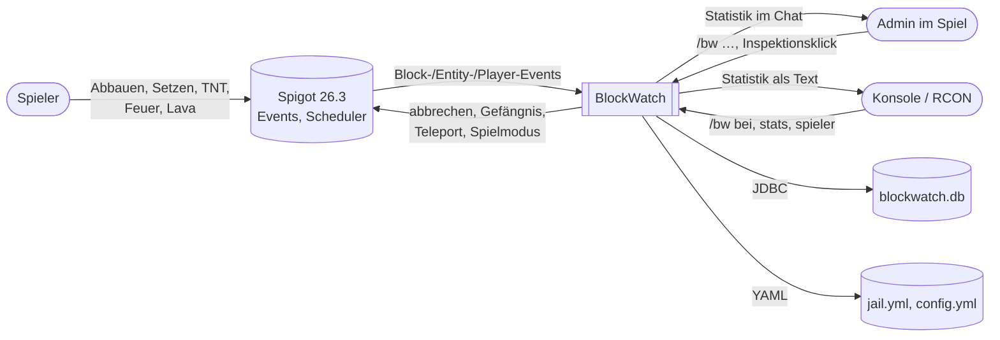

# 3. Kontextabgrenzung

| Partner | Richtung | Inhalt |
|---|---|---|
| Spigot-Events | ein | Abbau, Setzen, Zünden, TNT-Zündung, Eimer, Entity-Setzen, Explosionen, Brand, Interact, Join/Respawn/Teleport/Befehl |
| Spigot | aus | Events abbrechen, Teleport in die Zelle, Spielmodus, Zelle aus Grundgestein bauen |
| Admin im Spiel | beide | `/bw …`, Inspektionsmodus; Gefängnis-Hinweise an Online-OPs |
| Konsole / RCON | beide | Abfragen ohne Position (`/bw bei <welt> x y z`), synchron beantwortet |
| SQLite | aus/ein | Tabelle `events` |
| YAML | aus/ein | `jail.yml` (Insassen), `config.yml` (u. a. Zellenposition) |

Nicht im Umfang: Webseite, Discord, andere Plugins. Was andere Plugins/Skripte direkt per API
setzen (z. B. `Block.setType`), löst keine Spieler-Events aus und ist für BlockWatch unsichtbar
([Risiken](11-risiken.md)).
