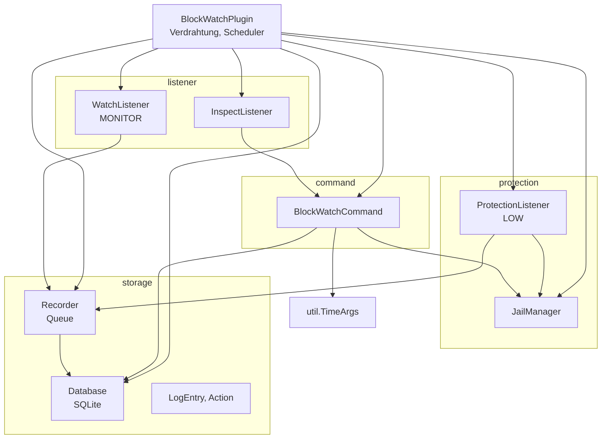

# 5. Bausteinsicht

Basis: `io.github.cndrbrbr.blockwatch`.

| Klasse | Verantwortung |
|---|---|
| `BlockWatchPlugin` | Start/Stopp, `config.yml` mit neuen Standardwerten ergänzen, Scheduler für Flush (40 Ticks) und tägliches Aufräumen (`retention-days`) |
| `listener.WatchListener` | Alle Protokoll-Events → `LogEntry`; Akteur auflösen; Explosionen ohne Blockschaden überspringen |
| `listener.InspectListener` | Im Inspektionsmodus Klick abbrechen und Statistik des Blocks (links) bzw. des Platzes davor (rechts) zeigen |
| `protection.ProtectionListener` | Verbotene Gegenstände (`protection.blocked`) abfangen: Interact, Place, Eimer, TNT-Zündung, Werfer; `BLOCKED` protokollieren, einsperren. Nur registriert, wenn `protection.enabled` |
| `protection.JailManager` | Insassen (`jail.yml`), Zelle finden oder bauen, Sekundentakt: Actionbar-Countdown, zurückholen, freilassen; sperrt Befehle und fremde Teleports |
| `command.BlockWatchCommand` | `/bw` mit Unterbefehlen, Tab-Completion, Ausgabe in Seiten, Inspektionsmodus-Zustand |
| `storage.Recorder` | Thread-sichere Queue, `flush()` schreibt Stapel |
| `storage.Database` | Schema, Insert im Stapel, Statistik-Abfragen (`materials`, `summary`), `purge` |
| `storage.Action` | Aktionsarten mit Text und Gefährlich-Kennzeichen |
| `storage.LogEntry` | Ein Eintrag (Zeit, Ort, Spieler-UUID oder null, Akteur, Aktion, Material) |
| `util.TimeArgs` | `30m`, `2h`, `7d`, `2w` → Millisekunden |

## Datenmodell

Eine Tabelle `events(id, ts, world, x, y, z, player, actor, action, material, danger)` mit Indizes
auf Position `(world, x, z, y)`, Akteur `(actor NOCASE, ts)`, Gefahr `(danger, ts)` und Zeit `(ts)`.
`player` ist die UUID oder `NULL`, `actor` der Anzeigename oder `#Ursache`.
