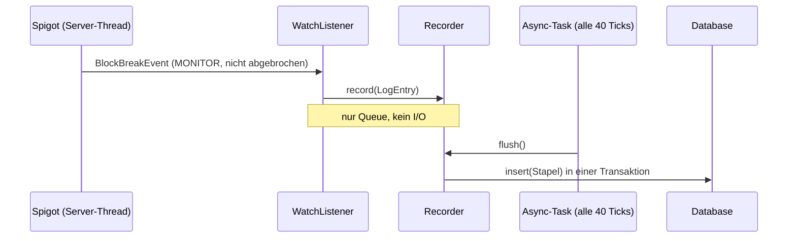
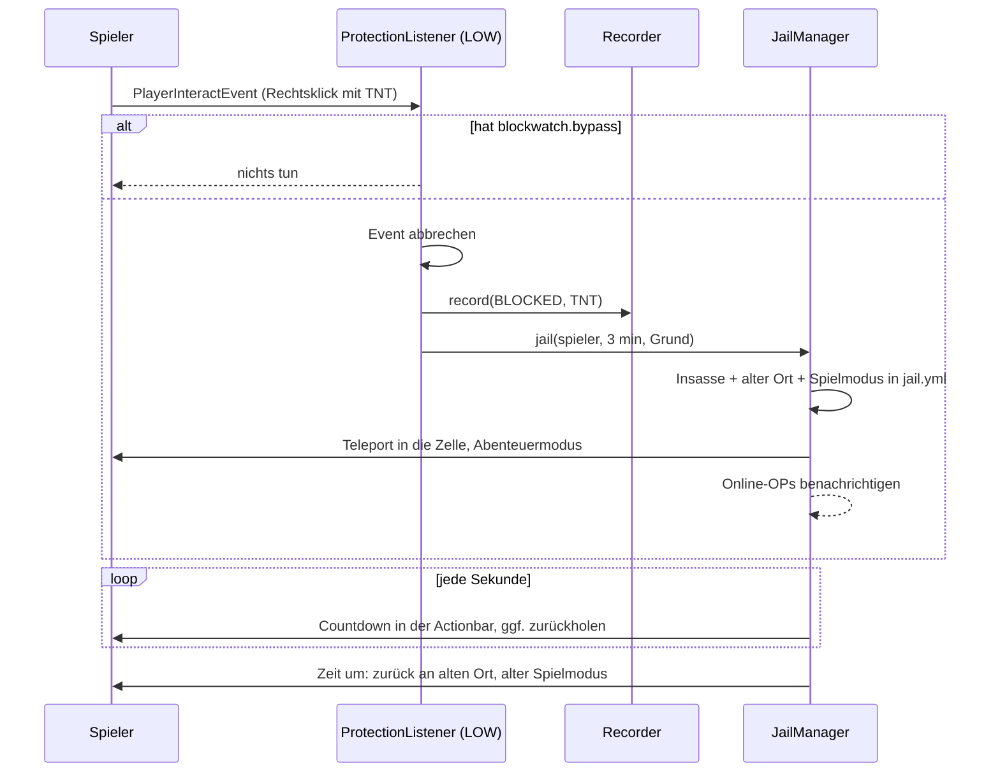

# 6. Laufzeitsicht

## 6.1 Ein Block wird abgebaut

Beim Stoppen ruft `onDisable` `flush()` noch einmal synchron auf.

## 6.2 Abfrage `/bw hier 10 2h`

1. `BlockWatchCommand` liest Radius und Zeit (`TimeArgs`), Reihenfolge egal.
2. **Spieler:** Async-Task → `Recorder.flush()` (damit Frisches dabei ist) → `Database.materials(...)`
   → zurück auf den Server-Thread → erste Seite in den Chat; das Ergebnis bleibt für `/bw seite`.
3. **Konsole/RCON:** dasselbe, aber direkt im Befehl
   ([ADR-0005](adr/0005-konsolenabfragen-synchron.md)).

## 6.3 Spieler ohne Recht setzt TNT

`BlockPlaceEvent`, Eimer und `TNTPrimeEvent` sind Rückfallebenen für Fälle, die der Rechtsklick
nicht erwischt. Werfer dürfen verbotene Gegenstände nicht ausgeben (ohne Strafe, kein Verantwortlicher).
Ist der Spieler offline, wenn die Zeit abläuft, wird er beim nächsten Login freigelassen.
